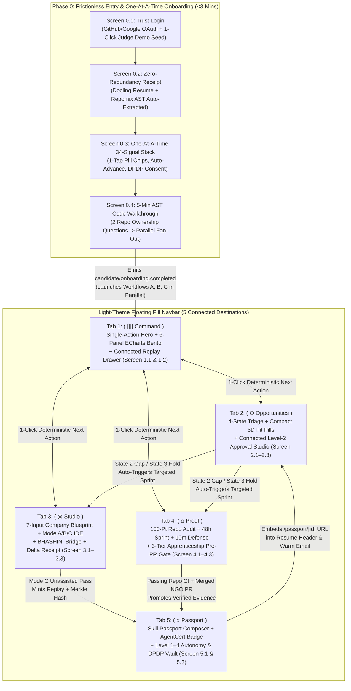

# HireX Bot: Psychological UI/UX Design System, Information Architecture & Multi-Perspective Screen Specification

**Project Name:** HireX Bot — Autonomous Proof-of-Work, Apprenticeship, and Employment Architecture for India's Youth Tech Workforce  
**Hackathon & Track:** [Code for a Billion — Bharat Agentic-AI Hackathon 2026](https://www.google.com/search?q=https%3A%2F%2Fcodeforindia.org%2Fhackathon) | **Track 10: Tech Employment for Youth**  
**Design Paradigm:** Architectural Monochrome Light Theme · Cognitive-Load Reduction · Behavioral Psychology UX  
**Typography Stack:** `Google Sans Flex, Arial, Helvetica, sans-serif` (Light/Regular Display & Prompts) + `Raleway, sans-serif` (Elegant Editorial Body & Micro-Copy) + `JetBrains Mono` (Code & Cryptographic Hashes)  
**Navigation & Geometry Archetype:** Light-Adapted Floating Pill Navbar · Ultra-Thin Hollow Icons (`1.25px` stroke) · Full-Pill Interactive Controls (`border-radius: 9999px`)  
**Companion Specifications:** `Idea.md` (Problem & Strategy) · `Product Requirements.md` (PRD & Tooling) · `Architecture.md` (Systems & 8-Table Schema)  

---

## 1. Tri-Perspective Hybrid Design Governance solves the Student, Judge, and Builder Trilemma

Every screen, interaction, word choice, and density boundary in **HireX Bot** is governed by a **Tri-Perspective Hybrid Decision Matrix**. In a national civic-tech hackathon evaluated on **Size of Problem (25%)**, **Severity (25%)**, **Quality of Solution (25%)**, and **Proven Impact (25%)** ([Code for India Hackathon](https://www.google.com/search?q=https%3A%2F%2Fcodeforindia.org%2Fhackathon)), designing solely for an idealized consumer user risks hiding the deep multi-agent engineering from judges; designing solely for judges creates an intimidating, telemetry-cluttered cockpit that overwhelms a stressed Tier-3 college graduate; and designing without engineering constraints breaks the 26-day build window (November 15, 2026 deadline).

| Design Dimension | Perspective 1: The User (Tier-2/3 Student Candidate) | Perspective 2: The Hackathon Judge (3-Minute Evaluator) | Perspective 3: Yours (Founder & System Architect) | The Hybrid Design Decision (Best-of-All-Worlds Resolution) |
| :--- | :--- | :--- | :--- | :--- |
| **Visual Theme & Emotional Tone** | Suffers from placement anxiety, impostor syndrome, and rejection fatigue after 30+ ghosted applications. Needs a calm, non-judgmental, daylight-readable interface. | Evaluates dozens of dark-mode AI wrappers that look identical. Immediately notices a gallery-grade, high-contrast **Monochrome Light Theme** that signals institutional authority. | Wants a strict token-based color system in Tailwind CSS / Shadcn UI where states never clash and light-theme contrast passes WCAG AAA automatically. | **Architectural Alabaster & Obsidian Monochrome Light Theme:** `#FAFAFA` paper canvas, `#FFFFFF` cards, `#E4E4E7` hairline borders, and `#0A0A0B` obsidian active pills—eliminating neon visual noise while maximizing daylight legibility on budget laptop/mobile screens. |
| **Navigation Bar & Tab Discovery** | Wants to see only 4–5 clear destinations without overwhelming sidebars or nested sub-menus. | Needs to verify all **4 Track 10 Pillars** (Job Discovery, Portfolio Building, Apprenticeships, Hiring Signals) within 10 seconds of landing. | Needs the 8 backend modules (`M1`–`M8`) mapped cleanly into top-level routes without duplicating state. | **5-Tab Light-Adapted Floating Pill Navbar:** Mirrors the reference pill bar (`Command`, `Opportunities`, `Studio`, `Proof`, `Passport`). Active tab expands into a high-contrast pill with icon + label; inactive tabs show only ultra-thin `1.25px` hollow icons. |
| **Onboarding & Data Intake (`Module 1`)** | Hates re-typing resume fields and abandons multi-input tax-form screens. Needs **one question at a time** with effortless 1-tap pill answers. | Wants to see the **34 HireX Bot Signals**, **DPDP Rule 3 Consent**, and **5-Minute AST Code Probe** working live without taking 15 minutes during the demo. | Needs structured JSON written to `candidate_profiles` in `<3 minutes` total wall-clock time. | **Endowed-Progress Extraction Receipt + One-Card-at-a-Time Auto-Advancing Stack:** Docling/Repomix pre-fills 100% of resume/GitHub facts first, then presents a single-question card stack using 1-tap rounded pills (`180ms` auto-advance) plus a **1-Click "Judge Instant-Seed" Pill** on Login. |
| **Information Density & Compactness** | Needs open breathing room during cognitive tasks (answering questions, writing code) so they don't freeze. | Wants high-density evidence when inspecting 5D job scores, 6 ECharts panels, and SHA-256 audit logs. | Needs predictable responsive CSS grid layouts that never overflow on 13-inch laptops. | **Contextual Dual-Density Law:** Single-focus cognitive screens (Login, Onboarding Question Card, Live Coding Prompt) enforce **55%+ open whitespace**; comparative triage screens (5D Job Cards, Panel F History Ledger, 48h Sprint Checklist) enforce **ultra-compact `36px–44px` rows**. |
| **Sponsor & Agent Telemetry Visibility** | Cares about career outcomes, not whether `Claude Haiku 4.5` or `GPT-5 Codex` ran the prompt. | Explicitly scores **Best Use of AgentFoundry Agents**, **TrustModel AgentCert**, and **xSpan CareHub Integration**. | Needs clean separation between user-facing UI and system observability. | **Ambient Provenance Micro-Badges + Toggleable "Judge X-Ray Pill":** Subtle inline badges (`AgentCert DV Verified`, `SMART-Code: Codex`, `BHASHINI Tamil`) sit quietly in card footers, while a bottom-left pill opens live Inngest/AgentFoundry trace drawers for judges. |

---

## 2. Visual Identity, Light-Theme Monochrome Palette & Typography Psychology

### 2.1 The Light-Theme Monochrome Color Architecture ("Obsidian on Alabaster")

To translate the reference dark-theme pill navbar into a bespoke **Light Theme** while preserving pure black-and-white contrast, the design system uses an **Inverted Focal Contrast Model**: the ambient workspace is airy, warm alabaster and pure white (`94%` of surface area), while **primary interactive commitments and active navigation states use solid Obsidian Black (`#0A0A0B`) pills with crisp white typography**.

| Token Name | Hex / RGBA Value | Tailwind / CSS Variable | Exact UI Surface Assignment | Psychological Rationale |
| :--- | :--- | :--- | :--- | :--- |
| **`--bg-canvas`** | `#FAFAFA` | `bg-zinc-50` | Global app background behind cards and onboarding stacks. | Eliminates the harsh glare of pure `#FFFFFF` on full-screen viewports, reducing eye strain during 45-minute coding mocks. |
| **`--bg-surface`** | `#FFFFFF` | `bg-white` | Primary cards, onboarding question stage, Monaco IDE wrapper, ECharts containers. | Creates effortless figure-ground separation against `#FAFAFA` using only a `1px` hairline border rather than heavy drop shadows. |
| **`--bg-subtle`** | `#F4F4F5` | `bg-zinc-100` | Inactive pill chips, compact table headers, code-output drawers, navbar track surface. | Signals secondary interactive affordance and groups compact metadata without introducing color clutter. |
| **`--bg-obsidian`** | `#0A0A0B` | `bg-zinc-950` | Active navigation tab pill, primary CTA buttons, selected onboarding answer pill, Skill Passport header badge. | Acts as an unmistakable visual magnet (Von Restorff Isolation Effect)—the user's eye instantly knows the primary action on every screen. |
| **`--border-hairline`** | `#E4E4E7` | `border-zinc-200` | All card outlines, table row dividers, inactive button outlines (`1px solid`). | Architectural precision; keeps dense data tables and 6-panel dashboards structured without visual heaviness. |
| **`--border-focus`** | `#18181B` | `border-zinc-900` | Active input focus ring, selected job card border (`1.5px solid`), active stage connector line. | Replaces default browser blue focus rings with calm, decisive monochrome authority. |
| **`--text-primary`** | `#0A0A0B` | `text-zinc-950` | Large display prompts, metric values, primary headings, active pill text (inverted `#FFFFFF`). | Maximum contrast (`19.4:1` against white) for instant scannability. |
| **`--text-secondary`** | `#52525B` | `text-zinc-600` | Raleway body explanations, rubric descriptions, company evidence citations. | Softens supporting prose so headings and numbers dominate the visual hierarchy. |
| **`--text-muted`** | `#71717A` | `text-zinc-500` | Timestamps, SHA-256 hash prefixes, inactive hollow icon stroke color, axis labels. | Recedes into the background until the user intentionally inspects metadata. |
| **`--signal-verified`** | `#18181B` fill + `1px` solid dot | Monochrome Status System | Used for *State 1 (Apply Now)*, *Passed CI Tests*, and *Confirmed Blueprints* (solid black dot `●` + pill). *State 2* uses half-filled dot `◐`; *State 3* uses hollow dotted ring `◌`; *State 4* uses strikethrough pill `⊘`. | Achieves 100% color-blind accessibility and preserves strict monochrome elegance while differentiating all 4 decision states via geometric iconography. |

### 2.2 Dual-Font Typographic System & Weight Psychology

The typographic pairing deliberately contrasts **architectural weightlessness at large scales** with **humanist editorial elegance at small scales**:

| Typographic Tier | Font Family Stack | Weight & Tracking Specification | Scale (`px` / `rem`) | Where It Is Used & Psychological Effect |
| :--- | :--- | :--- | :--- | :--- |
| **Tier 1: Hero Prompts & Onboarding Questions** | `'Google Sans Flex', Arial, Helvetica, sans-serif` | **`font-weight: 300` (Light)** · `letter-spacing: -0.03em` · `line-height: 1.2` | `28px–36px` (`1.75rem–2.25rem`) | Used for the one-at-a-time onboarding questions, Login welcome headline, and Tab 1 Single-Action Hero prompt. **Psychology:** Light-weight large text feels conversational, calm, and inviting rather than barking orders in heavy bold type. |
| **Tier 2: Metric Numerals & Section Assertions** | `'Google Sans Flex', Arial, Helvetica, sans-serif` | **`font-weight: 300` (Numerals) / `400` (Section Titles)** · `letter-spacing: -0.025em` · `tabular-nums` | `20px–32px` (`1.25rem–2.0rem`) | Used for Panel A's `76/100 (+18 pts)` delta scores, 100-point repo credibility scores, and card headers. **Psychology:** Thin, large tabular numerals make a `58/100` baseline score look like an objective scientific calibration reading rather than a red school grade. |
| **Tier 3: Elegant Body & Diagnostic Narrative** | `'Raleway', -apple-system, BlinkMacSystemFont, sans-serif` | **`font-weight: 400` (Regular) & `500` (Medium)** · `letter-spacing: 0.01em` · `line-height: 1.55` | `13.5px–15px` (`0.85rem–0.9375rem`) | Used for Socratic feedback, 4-State decision explanations, Issue Localization Maps, and resume tailoring rationales. **Psychology:** Raleway's geometric elegance lends warmth and bespoke editorial polish to dense explanatory text. |
| **Tier 4: Compact Micro-Copy, Pills & Table Cells** | `'Raleway', sans-serif` | **`font-weight: 500` (Medium) & `600` (SemiBold)** · `letter-spacing: 0.03em` | `11.5px–12.5px` (`0.72rem–0.78rem`) | Used inside 5D Fit Score pills, ECharts axis labels, confidence tier badges (`Verified — Official Documentation`), and compact table rows. **Psychology:**Slightly wider tracking at small sizes guarantees crisp legibility inside compact `28px`-tall pills. |
| **Tier 5: Code, AST Paths & Cryptographic Proofs** | `'JetBrains Mono', monospace` | **`font-weight: 400`** · `letter-spacing: 0em` | `12px–13px` (`0.75rem–0.8125rem`) | Used strictly inside `@monaco-editor/react`, Piston stdout/stderr logs, GitHub file paths (`src/controllers/order.py`), and `SHA-256` Merkle roots. |

### 2.3 Ultra-Thin Hollow Iconography, Pill Geometry & Micro-Interactions

1. **Ultra-Thin Hollow Icons (`1.25px` Stroke Specification):**
   * Every icon across HireX Bot uses un-filled, hollow vector paths (`fill: none`, `stroke: currentColor`, `stroke-width: 1.25px`, `stroke-linecap: round`, `stroke-linejoin: round`).
   * **Active-State Icon Transformation (Directly Inspired by `image_4f5437.png`):** When a navigation tab or action pill becomes active, the outer pill fills with Obsidian Black (`#0A0A0B`), the icon stroke inverts to Crisp White (`#FFFFFF` at `1.5px` stroke), and a subtle internal structural accent appears inside the icon (such as the twin vertical pause/pillar lines inside the Home roof in the reference image).
2. **Full-Pill Button & Container Curvature Hierarchy:**
   * **Interactive Buttons, Chips, Toggles & Navbar Shell:** `border-radius: 9999px` (100% full pill).
   * **Primary Stage Cards & Onboarding Question Cards:** `border-radius: 28px` (`1.75rem`).
   * **Bento Dashboard Panels & Split-Pane Containers:** `border-radius: 20px` (`1.25rem`).
   * **Compact Inner Pills & 5D Score Badges:** `border-radius: 9999px`, `height: 26px`, `padding: 0 10px`.

---

## 3. Psychological Copywriting & Framing Architecture

In an employment platform for first-time coders, **words are cognitive interventions**. Standard career portals trigger **threat appraisal** (using words like *Rejected, Weak, Ineligible, Unskilled, Failed Test*), which elevates cortisol and causes candidates to avoid practicing their weakest skills. HireX Bot replaces deficit language with **Calibration & Agency Framing**.

| UI Context & Module | Conventional UI Wording (Forbidden) | HireX Bot Psychological Wording (Enforced) | Exact Adjectives Used | Psychological & Behavioral Mechanism |
| :--- | :--- | :--- | :--- | :--- |
| **Login & Welcome (`/login`)** | *"Sign up to find jobs and take mock tests."* | **"Turn your actual code into your strongest hiring signal."** | *Actual, Verifiable, Direct, Immediate* | Shifts locus of control from external pedigree (*college tier*) to internal agency (*code you write*). |
| **Resume & GitHub Auto-Extraction (`/onboarding`)** | *"Parsing file... Please wait."* | **"Extracting your verified foundation so you never type twice."** | *Verified, Effortless, Zero-Redundancy* | **Endowed Progress Effect:** Shows the user that 60% of profile creation is already done before they answer Question 1. |
| **5-Minute Code Ownership Probe (`Module 1`)** | *"Mandatory Anti-Cheating Skill Test (5 Mins)"* | **"5-Minute Code Walkthrough: Show how your architecture thinks."** | *Authentic, Architectural, Grounded* | Eliminates test-proctoring dread; frames the AST probe as a respectful engineering conversation about their own repo. |
| **State 2 Job Classification (`Module 4`)** | *"Partial Match (68%) — Missing Jest Skill"* | **"Apply Today While Calibrating — Core Stack Verified, 48h Sprint Queued for Jest"** | *Eligible, Parallel, Actionable, Time-Protected* | Reinforces the **Reversed-Funnel Promise**: missing a *preferred* skill never blocks an immediate application. |
| **State 3 Job Classification (`Module 4`)** | *"Not Ready / Low Match (45%) — Do Not Apply"* | **"Cooldown Protected — Building Core Evidence via Matched 12h Sprint"** | *Protected, Strategic, Scoped, Achievable* | Reframes holding an application as a **strategic protection of the candidate's 6-month employer cooldown**, paired with an immediate bridge action. |
| **State 4 Job Classification (`Module 4`)** | *"You are Ineligible for this Job"* | **"Boundary Filtered — Excluded due to Upfront Fee / Predatory Bond / Batch Gate"** | *Filtered, Transparent, Guarded* | Protects self-efficacy: the system is protecting the candidate from a bad or mismatched listing, not judging the candidate as inadequate. |
| **Dashboard Panel D Heatmap (`Module 8`)** | *"Recurring Weaknesses & Failed Topics"* | **"Calibration Frontier — Unassisted vs. Guided Topic Trajectory"** | *Unassisted, Guided, Longitudinal, Targeted* | **Growth Mindset Framing (Dweck):** A `2/5` cell in Dynamic Programming is labeled an *active frontier with a 20-min Mode A bridge*, not a permanent deficit. |
| **Dashboard Panel E Readiness (`Module 8`)** | *"Probability of Passing Amazon SDE: 74%"* | **"Amazon SDE-1 Preparation Status: 3 of 4 Selection Stages Practiced"** | *Practiced, Calibrated, Verified, In-Progress* | **Anti-Overclaiming Guardrail:** Prevents false complacency and satisfies strict hackathon judging scrutiny on analytical honesty. |

---

## 4. The Light-Adapted Floating Pill Navigation Bar & Information Architecture

### 4.1 Translating the Reference Dark Navbar (`image_4f5437.png`) into Light Theme

The uploaded reference image (`image_4f5437.png`) demonstrates a high-craft psychological pattern: **Asymmetric Active-Label Expansion**. Instead of rendering 5 text labels side-by-side (which creates visual noise and forces equal visual weight across inactive tabs), **only the active tab displays its text label inside a contrasting pill**, while the other 4 tabs remain quiet, ultra-thin hollow icons.

In **HireX Bot's Light Theme**, we invert and refine this exact geometry:

```
+---------------------------------------------------------------------------------------------------+
|  OUTER PAGE HEADER: Alabaster Canvas (#FAFAFA)                                                    |
|                                                                                                   |
|   [ HireX Bot · Track 10 ]      +-------------------------------------------------------+        |
|                                  |  ( [||] Command )     ( O )     ( ◎ )    ( ⌂ )   ( ○ ) |        |
|                                  +-------------------------------------------------------+        |
|                                   ^ Active Pill:#0A0A0B   ^--------^--------^-------^             |
|                                     Text/Icon: #FFFFFF    Inactive Ultra-Thin Hollow Icons        |
|                                     Font: Google Sans     Stroke: 1.25px (#52525B -> #0A0A0B)     |
|                                     Radius: 9999px        Zero text clutter until selected        |
+---------------------------------------------------------------------------------------------------+
```

* **Outer Pill Track Specification:** `background: #FFFFFF`, `border: 1px solid #E4E4E7`, `border-radius: 9999px`, `padding: 6px`, `height: 56px`, `box-shadow: 0 10px 30px -5px rgba(10, 10, 11, 0.05)`.
* **Active Tab Pill Specification:** `background: #0A0A0B` (Obsidian Black), `color: #FFFFFF` (Pure White), `border-radius: 9999px`, `padding: 10px 20px`, `display: inline-flex`, `align-items: center`, `gap: 10px`, `transition: all 280ms cubic-bezier(0.22, 1, 0.36, 1)`. Font: `Google Sans Flex`, `14px`, `font-weight: 400`, `letter-spacing: -0.01em`.
* **Inactive Tab Specification:** `width: 44px`, `height: 44px`, `border-radius: 9999px`, `color: #52525B`, hollow SVG icon with `stroke-width: 1.25px`. On hover: `background: #F4F4F5`, `color: #0A0A0B`, subtle micro-tooltip below in `Raleway 11px`.

### 4.2 Why Exactly 5 Tabs? (Mapping 8 Modules to the Candidate's Mental Model)

A user does not think in terms of "8 backend modules"; a candidate thinks in a 5-part psychological journey:
1. **`Command` (Where do I stand & what do I do next?)** -> *Module 8 Analytics + Orchestrator Next-Action Hub*
2. **`Opportunities` (What jobs can I apply to right now?)** -> *Module 4 Discovery & 4-State Triage + Module 7 Tailoring & Safe Approval Queue*
3. **`Studio` (How do I practice for my target company's exact round?)** -> *Module 5 Blueprints, 7-Stage QC & Mode A/B/C Simulations + BHASHINI Bridge*
4. **`Proof` (How do I upgrade my GitHub & gain real work experience?)** -> *Module 2 Repo AST Architect + Module 3 Micro-Apprenticeships & PR Mentor*
5. **`Passport` (What verifiable proof do employers see & what are my privacy boundaries?)** -> *Module 6 Verifiable Skill Passport + Module 1/7 Autonomy & DPDP Vault*

*(Note: Pre-authenticated flows—`/login` and `/onboarding`—sit outside the 5-tab workspace so first-time users experience zero navigation distraction, while institutional Placement Officers switch into the dedicated **TPO Cohort Console** via a top-right workspace switcher pill.)*

### 4.3 Master Screen Inventory, Density Classification & Cross-Screen Connections

Two screens are visually and statefully connected (via split-pane master-detail, slide-over drawers, or shared context banners) **if and only if** an action in Screen A directly configures or verifies the artifact in Screen B.

| Navigation Tab / Route Group | Screen ID & Title | Modules Powered | Spatial Density Profile | Connected Screen(s) & Exact Connection Mechanism |
| :--- | :--- | :--- | :--- | :--- |
| **Pre-App Entry (`/login` & `/onboarding`)** | **Screen 0.1:** Minimalist Trust Login & Demo Role Switcher | Module 1 (Auth) | **Spacious (`65%` whitespace)** | Connects to **Screen 0.2** on OAuth return, or jumps directly to **Tab 1 (`Command`)** if `"Judge 1-Click Demo Cohort"` is clicked. |
| **Pre-App Entry (`/onboarding/extract`)** | **Screen 0.2:** Zero-Redundancy Extraction Receipt & Resume Dropzone | Module 1 (Docling + Repomix) | **Spacious (`55%` whitespace)** | Streams live parsed chips (`14 Skills`, `3 Repos`, `B.Tech 2026`) and auto-transitions (`400ms` morph) into **Screen 0.3**. |
| **Pre-App Entry (`/onboarding/signals`)** | **Screen 0.3:** One-At-A-Time 34-Signal Progressive Card Stack | Module 1 (Signals 1–34 + DPDP) | **Ultra-Clean Single Focus (`60%` whitespace)** | Each answered card slides up (`180ms`) into the next; Signal 30–34 locks the **DPDP Rule 3 Ledger** and transitions into **Screen 0.4**. |
| **Pre-App Entry (`/onboarding/probe`)** | **Screen 0.4:** 5-Minute AST Code-Ownership Walkthrough & Parallel Launch | Module 1 (`GPT-5 Codex` + Inngest) | **Focused Split-Pane (`45%` / `55%`)** | Submitting the 2 AST questions fires `candidate/onboarding.completed`, animating the **3-Track Parallel Fan-Out Bridge** directly into **Tab 1 (`Command`)**. |
| **Tab 1: `Command` (`/dashboard`)** | **Screen 1.1:** Single-Action Hero, Parallel Pulse Strip & 6-Panel Growth Bento (Panels A–F) | Module 8 (ECharts + Closed-Loop Engine) | **Hybrid:** Spacious Hero (`top 25%`) + **Compact Bento Grid (`bottom 75%`)** | Clicking the Hero CTA deep-links with pre-loaded state into **Screen 2.2** (Approve App), **Screen 3.2** (Mode A Drill), or **Screen 4.1** (48h Repo Sprint). |
| **Tab 1: `Command` (Drawer)** | **Screen 1.2:** Session Evidence & `Live Agent Replay` Inspector Drawer | Modules 5, 6 & 8 (`session_responses`) | **Compact Technical (`38px` rows + scrubber)** | **Connected to Panel F (History Table) in Screen 1.1:** Clicking any past session row slides open this 520px right drawer without leaving the dashboard. |
| **Tab 2: `Opportunities` (`/opportunities`)** | **Screen 2.1:** 4-State Triage Board & Compact 5D Fit Inspector | Module 4 (`JobSpy` + 5D Router) | **High-Compactness Triage (`44px` cards, `26px` 5D pills)** | **Master-Detail Connection:** Selecting any State 1/2 job card on the left immediately populates **Screen 2.2 (Approval Studio)** in the right pane; selecting a State 3 job links directly to the matched **Screen 4.3 Apprenticeship Sprint**. |
| **Tab 2: `Opportunities` (Connected Pane)** | **Screen 2.2:** Level-2 Human Approval Studio (Tailored PDF + 30m Micro-Deliverable + Warm Email) | Module 7 (`@react-pdf`, `Gmail API`) | **Compact Split Preview (`50%` PDF / `50%` Email & Proof)** | **Connected to Screen 2.1 & Screen 5.1:** Embeds the live **Skill Passport Badge** from Tab 5 and transitions to **Screen 2.3** upon `"Approve & Dispatch"`. |
| **Tab 2: `Opportunities` (Modal/Sub-View)** | **Screen 2.3:** Playwright Portal Handoff & Application Outcome Pipeline | Module 7 (`requires_user_input`) | **Compact Kanban / Action Sheet** | Pauses Inngest (`step.waitForEvent`) and surfaces an interactive browser handoff card whenever a portal requires a human CAPTCHA or legal declaration. |
| **Tab 3: `Studio` (`/interview`)** | **Screen 3.1:** 7-Input Company Blueprint Configurator & 10-Stage Selector | Module 5 (`interview_blueprints` + 7-Stage QC) | **Structured Medium Density** | Selecting Company + Role + Round + Mode (A/B/C) runs the 7-Stage QC check and launches **Screen 3.2** within the same viewport container. |
| **Tab 3: `Studio` (`/interview/[id]`)** | **Screen 3.2:** Mode A/B/C Simulation IDE, Piston Runner & BHASHINI Socratic Bridge | Module 5 (`Monaco`, `Piston`, `BHASHINI`) | **Compact IDE Workspace (Zero Outer Margin)** | **Connected to Screen 3.3:** Finishing the session writes an append-only row to `practice_sessions` and transitions into the **Screen 3.3 Delta Receipt**. |
| **Tab 3: `Studio` (Post-Session)** | **Screen 3.3:** Immutable Rubric Delta Receipt & Skill Passport Promotion Bridge | Modules 5, 6 & 8 | **Spacious Summary Card + Compact Rubric Bars** | Connects back to **Tab 1 (`Command`)** (updating Panel B/C/D) and, if `Mode C` was passed, offers a 1-click **"Publish Trace to Skill Passport"** bridge to **Tab 5**. |
| **Tab 4: `Proof` (`/proof`)** | **Screen 4.1:** 100-Point GitHub Credibility Scorecard & 48-Hour Upgrade Sprint | Module 2 (`Repomix` + `Octokit` + `Piston`) | **Compact 6-Row Scorecard + Ticket Checklist** | **Connected to Screen 4.2:** Once automated CI/test tickets pass, unlocks the connected **10-Minute Socratic Repo Defense Recorder** right beside the commit diff. |
| **Tab 4: `Proof` (Connected Sub-View)** | **Screen 4.2:** 10-Minute Socratic Repository Defense Studio | Module 2 (`Live Agent Replay`) | **Split Diff + Voice/Text Defense** | Links the graded defense transcript directly into `portfolio_artifacts` and promotes the verified repo badge to **Tab 5 (`Passport`)**. |
| **Tab 4: `Proof` (`/proof/sprints`)** | **Screen 4.3:** 3-Tier Micro-Apprenticeship Hub, AI Localization Map & Pre-PR Test Gate | Module 3 (`CFI NGOs`, `Algora`, `xSpan FHIR`) | **Compact Issue List + Focused Localization Map** | **Connected Pre-PR Gate:** The `"Open Public GitHub PR"` pill button remains locked until the inline **Piston Pre-PR Test Gate** turns solid black (`100% Passing`). |
| **Tab 5: `Passport` (`/passport-vault`)** | **Screen 5.1:** Candidate Skill Passport Live Composer & Recruiter View Telemetry | Module 6 (`TrustModel AgentCert DV` + Merkle Chain) | **Editorial Showcase Density** | Mirrors the public `/passport/[id]` route (Screen 6.1) and connects to **Screen 5.2** for privacy and autonomy governance. |
| **Tab 5: `Passport` (`/governance`)** | **Screen 5.2:** 4-Level Autonomy Controller, DPDP Rule 3 Consent Ledger & Offline Switch | Modules 1, 7 & 8 (DPDP + `Local Mode`) | **Compact Audit Ledger (`40px` rows)** | Controls the global Inngest state machine (`Level 1–4`) and provides the 1-click cascading `"Erase All My Data"` DPDP button. |
| **External Public Route (`/passport/[id]`)** | **Screen 6.1:** Zero-Login 60-Second Employer Verification Page | Module 6 (Public Edge Route) | **High-Signal Scannable 4-Block Grid** | Standalone read-only page opened by recruiters from tailored resumes and warm outreach emails; loads in `<1.2s`. |
| **Institutional Mode (`/tpo-console`)** | **Screen 7.1:** College Placement Officer (TPO) Governance & xSpan Burnout Triage Queue | Module 8 (`AgentFoundry Business Mode` + `xSpan`) | **High-Density Cohort Table (`36px` rows)** | Accessible via the role-switcher pill; connects `Skillify` employer rubrics and `Guardrail` policies directly to student workspaces. |

---

## 5. End-to-End Connected Screen Workflow & Behavioral Architecture



---

## 6. Deep-Dive Psychological Design of Login & One-At-A-Time Onboarding (Module 1)

### 6.1 Screen 0.1: Minimalist Trust Login & Multi-Persona Entry (`/login`)

Most hackathon apps fail within the first 15 seconds because judges are forced to create a fake account and upload a dummy PDF just to see the dashboard, while real students hesitate to link their GitHub or Gmail out of fear of spam.

* **Visual Layout:** Centered single-column architectural card (`max-width: 460px`, `background: #FFFFFF`, `border: 1px solid #E4E4E7`, `border-radius: 28px`, `padding: 40px`) floating on `#FAFAFA`.
* **Psychological Micro-Copy:**
  * **Eyebrow Pill (`Raleway 11px Medium`, `#F4F4F5` pill):** `BHARAT AGENTIC-AI INFRASTRUCTURE · TRACK 10`
  * **Headline (`Google Sans Flex 30px Light`, `#0A0A0B`):** `"Your degree opens the door. Your verified code gets you hired."`
  * **Sub-headline (`Raleway 14px Regular`, `#52525B`):** `"We inspect your existing repositories and resume once so you never fill out repetitive job forms again."`
* **Primary Action Pills (`border-radius: 9999px`, `height: 48px`):**
  1. **Solid Obsidian Pill (`#0A0A0B` bg, `#FFFFFF` text):** `[ Hollow GitHub Icon ] Continue with GitHub (Recommended for Repo Audit)`
  2. **Crisp Outlined Pill (`#FFFFFF` bg, `#18181B` text, `1px solid #E4E4E7`):** `[ Hollow Google Icon ] Continue with Google Workspace`
* **The Hybrid Judge & TPO Fast-Track Bar (Bottom Compact Strip):**
  * Separated by a `1px` hairline divider, a compact `36px` bar offers two instant-seed pills for evaluators:
    * `[ ⚡ Judge 1-Click Demo: Load Tier-3 CSE Candidate (S4 Longitudinal Data) ]`
    * `[ 🏛️ Switch to Institutional TPO Cohort Console ]`

### 6.2 Screen 0.2: The Zero-Redundancy Extraction Receipt (`/onboarding/extract`)

Immediately after the candidate drops their PDF/DOCX resume (`IBM Docling`) and links GitHub (`Repomix --compress`), **we do not show a form**. We show a 4-second **Endowed Progress Receipt Card**:

* **Headline (`Google Sans Flex 26px Light`):** `"We extracted 18 verified facts from your resume and GitHub. You won't be asked to re-type a single one."`
* **Compact Auto-Extracted Chip Grid (`background: #F4F4F5`, `border-radius: 16px`, `padding: 16px`):** Displays compact, check-marked monochrome pills: `✓ B.E. CSE · 2026 Batch`, `✓ Python, FastAPI, React, PostgreSQL`, `✓ 3 Public Repositories Indexed (142 Commits)`, `✓ 1 AICTE Virtual Internship Found`.
* **Primary Pill CTA:** `"Complete Your 2-Minute Preferences (One Question at a Time) →"`

### 6.3 Screen 0.3: The One-At-A-Time 34-Signal Progressive Card Stack (`/onboarding/signals`)

To collect **34 non-inferable human signals** in under 150 seconds without cognitive fatigue, HireX Bot replaces multi-field forms with a **Single-Question Behavioral Card Stack** governed by five psychological rules:

1. **Strict One-Prompt-Per-Viewport Rule:** Only **one single question** is visible on screen at any moment (`Google Sans Flex 28px Light` centered at the top of a `580px`-wide card). The next question is physically absent from the DOM viewport until the current one is answered.
2. **Tap-to-Advance Pill Mechanics (Zero Unnecessary Clicking):**
   * For single-choice questions (e.g., *Signal 6: Work Mode*, *Signal 16: Applications Sent*, *Signal 27: Weekly Prep Hours*), tapping a rounded pill option (`border-radius: 9999px`, `height: 46px`) immediately fills the pill in Obsidian Black (`#0A0A0B`), pauses `160ms` for visual confirmation, and **auto-advances** to the next question card with no need to click a separate "Next" button.
   * For multi-select questions (e.g., *Signal 1: Target Roles — pick up to 3*), tapping pills toggles them into `#0A0A0B`, and pressing `Enter` or tapping the bottom pill (`"Continue (2 selected) →"`) advances.
3. **Psychological Chunking into 7 Breathable Chapters (Progress Bar Psychology):**
   * Showing `"Question 1 of 34"` triggers abandonment. Instead, the top header shows **7 compact chapter pills** (`Goals` · `Boundaries` · `Profiles` · `Search History` · `Interviews` · `Constraints` · `Permissions`) where each chapter contains only 4–5 rapid-fire taps, and smart conditional logic **auto-skips** irrelevant signals (typically reducing actual taps to 19–22 cards!).
4. **"Why We Ask This" Micro-Transparency Line:**
   * Below every question title sits a single line in `Raleway 13px Regular (#71717A)` explaining how that exact answer protects the candidate.

#### Representative One-At-A-Time Card Specifications Across the 7 Chapters

| Chapter & Signals | Exact Question Prompt (`Google Sans Flex 28px Light`) | Psychological Micro-Explanation (`Raleway 13px`) | Interactive Answer Control (Effortless 1-Tap Format) | Conditional Skip / Downstream Wiring |
| :--- | :--- | :--- | :--- | :--- |
| **Ch. 1: Career Goals** (`Signals 1–4`) | *"Which engineering roles should we actively hunt and calibrate for you right now?"* | *"We launch live job discovery the moment you finish—pick up to 3 core tracks."* | 8 large rounded pills in a 2-column grid (`Backend SDE`, `Full-Stack`, `Frontend / UI`, `Data / ML Engineer`, `QA & Test Automation`, `DevOps / Cloud`, `Mobile`, `Open to Apprenticeships`). | Pre-loads `interview_blueprints` role weights and `JobSpy` search queries. |
| **Ch. 2: Livelihood Boundaries** (`Signals 5–10`) | *"What is the minimum monthly stipend or annual CTC that respects your financial reality?"* | *"We use this as a hard eligibility floor so we never waste your time on exploitative or unpaid roles."* | Interactive horizontal pill slider (`₹0 / Academic Credit Only` · `₹10k–₹20k/mo` · `₹3.5–5 LPA` · `₹6–10 LPA` · `₹10+ LPA`) + 1-tap toggle: `"Block roles with training bonds or upfront fees" (Default: ON)`. | Configures Dimension 1 (`eligibility_pass`) and Dimension 5 (`opportunity_quality_pass`) in Module 4. |
| **Ch. 3: Missing Profiles** (`Signals 11–15`) | *"Do you have a live deployed project or coding profile we didn't see on your resume?"* | *"Already extracted: `github.com/candidate`. Add LeetCode or live URLs only if you want them audited."* | Pre-filled verified pills + 1 optional pill input with a prominent `"Skip — My GitHub is Enough →"` pill button (`hotkey: Enter`). | Zero-Redundancy Rule: skips any URL already found by `IBM Docling`. |
| **Ch. 4: Search Diagnostic** (`Signals 16–20`) | *"Roughly how many off-campus applications have you sent recently, and what happened?"* | *"This helps us diagnose whether your bottleneck is resume signaling, portfolio proof, or interview conversion."* | 4 single-tap auto-advancing scenario pills: `(A) Haven't started applying yet`, `(B) <15 applied · Getting some replies`, `(C) 30+ applied · Almost zero replies (Ghosted)`, `(D) Reaching OAs/Interviews · Struggling to convert`. | Selecting `(C)` immediately triggers **FR-105 (Portfolio & Warm Proof-of-Work Priority)** in the orchestrator! |
| **Ch. 5: Interview History** (`Signals 21–24`) | *"Which interview stage feels hardest when the clock is ticking?"* | *"Your answer sets your initial Mode A practice focus without ever lowering your target company bar."* | Single-tap or multi-tap pills: `Timed Online Assessments (OA)`, `Explaining Time/Space Complexity Live`, `Dynamic Programming & Graphs`, `Defending My Projects Deeply`, `System Design`, `Haven't attended a live interview yet`. | Selecting `"Haven't attended yet"` **auto-skips Signals 22 & 23**, saving 30 seconds! |
| **Ch. 6: Practical Reality** (`Signals 25–29`) | *"Which language feels most natural when you're thinking through a tough algorithm out loud?"* | *"In Mode A practice, you can reason in your native language via BHASHINI before rehearsing crisp English delivery."* | 7 rounded language pills (`English Only`, `தமிழ் + English`, `हिन्दी + English`, `తెలుగు + English`, `ಕನ್ನಡ + English`, `বাংলা + English`, `मराठी + English`) + compact toggle pills for `"100% Free Learning Resources Only"` & `"Low-Bandwidth / Offline Local Mode"`. | Configures `preferred_language` (`BHASHINI ULCA API`), `Ollama Local Mode`, and free `NASSCOM / Skill Up India` routing. |
| **Ch. 7: Autonomy & DPDP** (`Signals 30–34`) | *"How much autonomy should your agents have when applying and drafting outreach?"* | *"Protected under India's DPDP Rules 2025. You can pause any agent or erase all your data in 1 click anytime."* | 4 clear horizontal pill cards (**Level 1: Research Only**, **Level 2: Prepare Everything — Ask Me Before Sending [Recommended]**, **Level 3: Auto-Execute Within My Salary/Role Rules**, **Level 4: Full Strategy Adaptation**) + itemized DPDP consent toggles. | Writes timestamped `dpdp_consent_ledger` and sets `autonomy_level` (`Default = 2`). |

### 6.4 Screen 0.4: The 5-Minute AST Code-Ownership Walkthrough (`/onboarding/probe`)

Immediately after the last card of Chapter 7, the card smoothly widens (`max-width: 960px`) into the **5-Minute Code-Ownership Walkthrough**:
* **Left Pane (`40%` width, `#FFFFFF`):** Displays the exact function snippet extracted from the candidate's own primary GitHub repository via `Repomix` (e.g., `src/api/routes.py · lines 42–68`) alongside **2 conversational architectural prompts** generated by `GPT-5 Codex`.
* **Right Pane (`60%` width):** A clean `@monaco-editor/react` response pad (with a 5:00 calm monochrome pill countdown timer) where the candidate either edits a 15-line edge-case fix or types/speaks a concise explanation of how their function handles failure states.
* **The Parallel Fan-Out Transition:** Clicking `"Verify Ownership & Launch Workspace"` displays a 3-second live architectural confirmation card showing **Workflow A (JobSpy/NCS/AICTE Discovery)**, **Workflow B (Tailoring Queue)**, and **Workflow C (Blueprint Calibration)** all switching to `RUNNING` simultaneously before landing on **Tab 1 (`Command`)**.

---

## 7. Detailed Screen-by-Screen Specifications Across the 5 Pill Navigation Tabs

### 7.1 Tab 1: `Command` — Single-Action Hero & 6-Panel Longitudinal Growth Bento (`Module 8`)

**Psychological Purpose:** Eliminate "dashboard paralysis." When a candidate opens HireX Bot, they should never wonder which of the 8 modules to click first. Screen 1.1 places the **Deterministic Single Next Action** at the top, followed by the **6 Learning-Analytics Panels** in a high-contrast, scannable Bento Grid.

```
+---------------------------------------------------------------------------------------------------+
|  [ LIVE PARALLEL PULSE STRIP — Compact 36px Height ]                                              |
|  ● Workflow A: 14 Eligible Roles Found   ● Workflow B: 2 Packages Awaiting Your Approval [Review] |
|  ● Workflow C: Amazon SDE-1 Blueprint Calibrated   ● Local Mode: Ready  |  [ 🏛️ TPO / Judge View ] |
+---------------------------------------------------------------------------------------------------+
|  SCREEN 1.1 TOP HERO: DETERMINISTIC NEXT-ACTION COMMAND CARD (Radius: 28px, White #FFFFFF)        |
|                                                                                                   |
|  RECOMMENDED NEXT STEP · CLOSED-LOOP DIAGNOSTIC RULE #2                                           |
|  "Your code passed 100% of test cases in Session 3, but verbal complexity defense scored 2/5."    |
|  Complete a 15-minute Bilingual Socratic Articulation Drill (Tamil/English) before sending your   |
|  pending State 2 application to Zoho Corp.                                                        |
|                                                                                                   |
|  ( ▶ Launch 15-Min Socratic Drill )   ( Review 2 Ready Applications First -> )                    |
+---------------------------------------------------------------------------------------------------+
|  PANEL A: OVERALL PREPARATION SUMMARY (4 Compact Metric Cards — Height: 104px each)               |
|  +-----------------------+ +-------------------------+ +-----------------------+ +--------------+ |
|  | COMPLETED SESSIONS    | | CODING ROUND VS BASELINE| | CALIBRATION FRONTIERS | | ACTIVE FOCUS | |
|  | 12                    | | 76/100  (+18 pts)       | | 2 Topics              | | DP & Verbal  | |
|  | 9 Unassisted · 3 ModeA| | vs. Session 1 (Oct 14)  | | DP (2/5), Verbal (2/5)| | Complexity   | |
|  +-----------------------+ +-------------------------+ +-----------------------+ +--------------+ |
+---------------------------------------------------------------------------------------------------+
|  PANEL B: PERFORMANCE IMPROVEMENT OVER TIME (50%)  |  PANEL C: ABILITY BY CRITERION (50%)         |
|  [Company: Amazon ▾] [Role: SDE-1 ▾] [Round: Coding ▾] |  [Round Filter: Coding Interview ▾]      |
|  (Strict Filter Lock: Never mixes Coding & Behav.) |  Correctness          ████████████░░ 4.5/5   |
|    100 |                                    ● 76   |  Problem Decomp.      ██████████░░░░ 3.8/5   |
|     75 |                         ● 67              |  Code Quality         ██████████░░░░ 4.0/5   |
|     50 |              ● 58                         |  Time/Space Complex.  █████░░░░░░░░░ 2.1/5 ! |
|        +-----------------------------------------  |  Verbal Explanation   █████░░░░░░░░░ 2.0/5 ! |
|          S1 (Base)    S2         S3        S4      |  (Shows Latest vs. Previous vs. Target Line) |
+----------------------------------------------------+----------------------------------------------+
|  PANEL D: RECURRING PATTERN HEATMAP (55%)          |  PANEL E: COMPANY PREPARATION STATUS (45%)   |
|  Topic / Session    S1     S2     S3     S4        |  Target: Amazon India · SDE-1 (University)   |
|  Arrays & Hashing  [3/5]  [4/5]  [5/5]  [5/5]      |  Label: PREPARATION STATUS (Not Pass Prob.)  |
|  Trees & Graphs    [2/5]  [3/5*] [4/5]  [4/5]      |  1. Online Assessment     [● Practiced     ] |
|  Dynamic Prog.     [1/5]  [1/5*] [2/5*] [2/5] <-   |  2. Coding Interview      [◐ In Progress   ] |
|  Verbal Complexity [2/5]  [2/5]  [2/5]  [2/5] <-   |  3. Project Defense       [◌ Needs Practice] |
|  (* = Mode A Hint-Assisted | Solid = Unassisted)   |  4. Behavioral (LP Loop)  [◐ In Progress   ] |
+----------------------------------------------------+----------------------------------------------+
|  PANEL F: IMMUTABLE PRACTICE HISTORY, FEEDBACK & OUTCOME LEDGER (Ultra-Compact 40px Rows)         |
|  Date    | Company   | Round  | Mode   | Score       | Unassisted | Action                        |
|  Oct 20  | Amazon    | Coding | Mode B | 76/100 (+18)| Yes (✓)    | ( Inspect Replay & Rubric -> )|
|  Oct 18  | Zoho Corp | Pract. | Mode A | 69/100 (+11)| Assisted(*)| ( Inspect Replay & Rubric -> )|
|  Oct 14  | Amazon    | Coding | Mode B | 58/100 (Base)| Yes (✓)   | ( Inspect Replay & Rubric -> )|
+---------------------------------------------------------------------------------------------------+
```

* **How Screen 1.2 (The Replay & Evidence Drawer) Connects to Panel F:** Clicking `( Inspect Replay & Rubric -> )` on any row in Panel F smoothly opens a `520px`-wide slide-over drawer on the right edge of Screen 1.1. The drawer renders the exact prompt asked, the candidate's submitted code diff, the 6 criterion scores, the interactive **`AgentFoundry Live Agent Replay` timeline scrubber**, and a bottom pill button: `"Practice This Exact Weakness in Studio →"` (which transitions directly to Tab 3 with that topic pre-loaded).

---

### 7.2 Tab 2: `Opportunities` — Reversed-Funnel Triage & Level-2 Approval Studio (`Modules 4 & 7`)

**Psychological Purpose:** Show the candidate that job hunting is happening *right now* on Day 1, while eliminating the cognitive terror of "Did the AI just send a hallucinated resume to a recruiter?" via a crystal-clear **Connected Master-Detail Approval Studio**.

* **Top Filter Pill Strip (`height: 44px`):** Four segmented state pills with live counts:
  * `( ● State 1: Apply Now · 4 )` — Solid Obsidian pill when selected
  * `( ◐ State 2: Apply While Calibrating · 6 )` — Highlights jobs where the candidate applies *today* while a 48h sprint closes a preferred skill gap
  * `( ◌ State 3: Cooldown Protected · 5 )` — Shows jobs held to protect the employer's 6-month re-application window, paired with a matched micro-apprenticeship
  * `( ⊘ State 4: Boundary Filtered · 9 )` — Collapsed by default; expandable to show why predatory/bond/ineligible listings were blocked
* **Compact Left List (`42%` width — Screen 2.1): High-Density Job Cards (`padding: 14px 16px`):**
  * Each job card is intentionally compact (`height: ~108px`) so 5–6 opportunities are visible simultaneously without scrolling.
  * **Row 1:** Company Name + Role Title (`Google Sans Flex 16px Regular`) + Source Pill (`AICTE-NASSCOM` / `Unstop` / `Greenhouse` / `NCS`) + Closing Countdown (`Closes in 42h`).
  * **Row 2 (The Compact 5D Fit Strip — Zero Composite Score Masking):** Five mini-pills (`height: 24px`, `Raleway 11px Medium`) placed horizontally:
    `[✓ Eligible]` · `[Role Fit: 84]` · `[Evidence: 72]` · `[Readiness: 64]` · `[✓ Zero-Bond Verified]`
* **Connected Right Pane (`58%` width — Screen 2.2): The Level-2 Human Approval Studio:**
  * Clicking any State 1 or State 2 card on the left immediately loads its prepared application package in the right pane (`Inngest state: awaiting_approval`):
  * **Sub-Tab Pill 1 (`Truthfully Tailored ATS Resume`):** Side-by-side diff highlighting the exact bullet points reordered by `Claude Haiku 4.5` from verified `portfolio_artifacts` and `apprenticeship_sprints`, with a top banner: `"Zero-Fabrication Guardrail Active: 100% of claims traced to verified commits"` and a download button for the `@react-pdf/renderer` vector PDF.
  * **Sub-Tab Pill 2 (`30-Min Diagnostic Micro-Deliverable & Warm Outreach`):** Displays the role-specific micro-artifact synthesized by `GPT-5 Codex` (e.g., an automated Playwright smoke test or API schema validation script for the target startup) alongside the pre-drafted Gmail outreach email embedding the candidate's `/passport/[id]` link.
  * **Bottom Sticky Action Bar (`height: 64px`, `#FFFFFF`):**
    * Primary Obsidian Pill (`#0A0A0B`): `"Approve & Dispatch Application + Warm Email →"` (resumes Inngest `step.waitForEvent("application/approval.resolved")`).
    * Secondary Outlined Pill (`State 2 only`): `"Approve Application Now + Start 48h Jest Sprint in Parallel"`.

---

### 7.3 Tab 3: `Studio` — Company Blueprint Configurator & Mode A/B/C Simulation Arena (`Module 5`)

**Psychological Purpose:** Separate supportive learning (**Mode A**) from realistic employer benchmarking (**Mode B**) and tamper-evident certification (**Mode C**) so the candidate never confuses hint-assisted practice with target-bar readiness.

* **Screen 3.1: Compact Blueprint Header & 3-Mode Calibration Selector:**
  * Rather than forcing the user through a 5-page setup wizard, Screen 3.1 uses a **Compact Architectural Control Bar (`height: 72px`)** at the top of the Studio:
    * **7-Input Pill Selectors:** `[ Company: Amazon India ▾ ]` · `[ Role: SDE-1 (Fresher) ▾ ]` · `[ Round: Stage 4 — Coding Interview (45m) ▾ ]`
    * **5-Tier Evidence Provenance Pill:** `[ ✓ Verified — Official Documentation (Amazon SDE Prep) ]` (clicking opens a popover with the exact Jina-extracted source URLs and competency weights).
    * **7-Stage QC Verification Badge:** `[ ✓ 7/7 QC Checks Passed · Piston Ref Solution: 42ms ]`
  * **The 3 Calibration Mode Pills (Psychological Separation of Safety vs. Evaluation):**
    1. **`( Mode A · Guided & Bilingual Socratic )`** — *Subtitle:* `"Untimed · Progressive hints · Tamil/Hindi/Telugu voice & text bridge · Offline Ollama ready"`
    2. **`( Mode B · Target-Level Mock )`** — *Subtitle:* `"45:00 Clock · Locked to Amazon SDE-1 bar · Zero hints · Updates Δ Score"`
    3. **`( Mode C · Proctored Skill Passport Run )`** — *Subtitle:* `"Strict timer · SHA-256 Replay logged · Mints employer-verifiable AgentCert badge"`
* **Screen 3.2: Connected Split-Pane Simulation Workspace (When Session Starts):**
  * The global top pill navbar auto-collapses into a thin `36px` focus strip (`[ ← Exit Session ] · [ Mode B: Amazon SDE-1 Coding ] · [ ⏱ 38:14 ]`) to maximize vertical IDE space.
  * **Left Pane (`38%` width — Problem & Socratic Dialogue):**
    * Top half: Crisp problem specification, input/output constraints, and clarifying-question chat thread.
    * Bottom half (Active in **Mode A**): **The Digital India BHASHINI Vernacular Bridge Card**. The candidate can click the hollow microphone pill (`[ 🎙️ Speak Logic in தமிழ் / हिन्दी / తెలుగు ]`) to explain their recurrence relation or graph traversal in their native language; `Claude Haiku 4.5` validates their logic Socratically and displays a side-by-side **"60-Second Crisp English Interview Pitch"** for them to rehearse out loud.
  * **Right Pane (`62%` width — `@monaco-editor/react` + Compact Piston Console):**
    * Top `70%`: Clean light-theme Monaco editor (`vs-light` customized with `#FFFFFF` background and `#F4F4F5` gutter) with language selector (`Python 3.12`, `Java 21`, `C++ 20`, `JavaScript/TS`, `SQL`).
    * Bottom `30%`: Ultra-compact **Piston Sandbox Drawer** showing public test cases, custom edge-case inputs, execution latency (`18ms / 3000ms limit`), memory footprint (`14.2 MB`), and `[ ▶ Run Code ]` / `[ ✓ Submit Final Response ]` pill buttons.
* **Screen 3.3: Connected Post-Session Immutable Delta Receipt:**
  * Submitting the session smoothly morphs Screen 3.2 into the **Session Receipt Card**, displaying the new `weighted_score`, the exact $\Delta 	ext{Score}$ gain against Session 1 baseline, a 6-bar criterion comparison, and—if completed in Mode C—a prominent Obsidian pill: `"Mint This Session to Your Public Skill Passport →"`.

---

### 7.4 Tab 4: `Proof` — GitHub AST Architect & 3-Tier Micro-Apprenticeship Hub (`Modules 2 & 3`)

**Psychological Purpose:** Cure the "tutorial clone syndrome" and the "fresher cold-start paradox" in one unified workspace where every action produces a public GitHub commit or merged Pull Request.

* **Top Sub-Navigation Pill Switcher:**
  * `( Repository Proof-of-Work Architect · Module 2 )`  |  `( Micro-Apprenticeships & Civic Bounties · Module 3 )`
* **Screen 4.1 & 4.2 (Connected Master-Detail): 100-Point Repo Audit, 48h Upgrade Sprint & 10m Defense:**
  * **Left Column (`45%` width — Compact 6-Dimension Credibility Card):**
    * Displays the overall score (`62/100 -> Target: 80+`) in `Google Sans Flex 36px Light` alongside 6 compact horizontal progress bars:
      1. `Problem Authenticity (14/20)`
      2. `Automated Testing & Edge Cases (8/25)` — Flagged as top leverage!
      3. `Commit Hygiene & Secret Scrubbing (12/15)`
      4. `Operational CI/CD & Live HTTP 200 (10/15)`
      5. `Architecture README & Mermaid Spec (6/10)`
      6. `Recorded Socratic Code Defense (12/15)`
  * **Right Column (`55%` width — Connected 48-Hour Upgrade Sprint & Defense Studio):**
    * Lists 3 concrete, checkable engineering tickets generated by `GPT-5 Codex` from the `Repomix` AST summary (e.g., *"Ticket #1: Add 5 pytest boundary tests in `tests/test_orders.py` for expired tokens and null payloads — +14 Credibility Pts"*).
    * **Live Webhook & Piston Verification Bar:** When the candidate pushes a commit to GitHub, this compact bar animates live (`Octokit Webhook Detected Commit a8f921 -> Running Piston Test Suite -> 5/5 Tests Passed -> Score Updated to 76/100!`).
    * **Connected Screen 4.2 Trigger:** Once code tickets pass, the bottom card unlocks the **10-Minute Socratic Repo Defense**, showing the candidate's actual commit diff while recording a 4-question architectural defense for their Skill Passport.
* **Screen 4.3: 3-Tier Micro-Apprenticeship Marketplace & Private Pre-PR Quality Gate (`Module 3`):**
  * **Top Tier Filter Pills:** `( Tier A: Code for India NGO Sprints )` · `( Tier B: Algora Open-Source Bounties )` · `( Tier C: Startup & xSpan CareHub FHIR Tasks )`
  * **Left List (`40%` width):** Compact 5-to-20-hour issue cards showing organization logo, stack pills, scoped hours (`12h Sprint`), and hiring signal reward (`Mints Civic-Tech PR Badge`).
  * **Right Connected Workspace (`60%` width — The Beginner-Safe PR Mentor):**
    * **Block 1: AI Issue Localization Map (`Repomix` + `GPT-5 Codex`):** Eliminates open-source intimidation by showing the exact 2–3 files and line numbers governing the issue (e.g., `1. Inspect fhir_webhook.py (Lines 88–112)` -> `2. Update schema validator in models/patient.py` -> `3. Run pytest tests/fhir/`).
    * **Block 2: Private Pre-PR Diff Critique & Piston Gate:** Before the candidate can embarrass themselves on a public NGO repository, they paste or sync their local branch diff here. The agent runs the upstream test suite in Piston and checks code style. **The `"Open Public GitHub Pull Request →"` pill button is physically disabled until `pre_pr_test_passed == true`**, turning solid Obsidian Black once all checks pass.

---

### 7.5 Tab 5: `Passport` — Verifiable Skill Passport Composer & DPDP Governance Vault (`Modules 6, 1 & 7`)

**Psychological Purpose:** Give the candidate tangible pride of ownership over their cryptographic hiring credentials (`Screen 5.1`) and total peace of mind over their personal data and agent autonomy boundaries (`Screen 5.2`).

* **Screen 5.1: Skill Passport Live Preview & Recruiter Inspection Telemetry:**
  * Displays a live interactive preview of the candidate's public `/passport/[passport_id]` page (identical to **Screen 6.1** below), paired with a top compact telemetry bar:
    * `[ Public URL: hirexbot.in/passport/arjun-k-2026 ]` · `( Copy Verified Link )` · `( Download ATS Resume with Embedded Passport QR/Link )` · `● 7 Employer Inspections This Week (Avg. View Time: 54s)`
* **Screen 5.2: Autonomy Governance & DPDP Rules 2025 Privacy Vault:**
  * **4-Level Autonomy Selector Cards:** Allows the candidate to switch between **Level 1 (Research)**, **Level 2 (Prepare & Ask Approval — Default)**, **Level 3 (Auto-Execute Within Rules)**, and **Level 4 (Adapt Strategy)** with explicit compact sliders for Level 3 boundary rules (`Minimum CTC Floor`, `Allowed Cities`, `Max Applications Per Day: 5`).
  * **Itemized DPDP Rule 3 Consent Ledger:** A clean, compact table listing every granted permission (`Resume & GitHub AST Parsing`, `Gmail OAuth Draft Creation`, `Public Skill Passport Hosting`), the exact ISO timestamp granted, and individual toggle switches to revoke any scope independently.
  * **1-Click Cascading Erasure (`DELETE /api/candidate/erase`):** A calm, clearly labeled outlined pill button (`"Erase All My Data & Revoke OAuth Tokens"`) that triggers `ON DELETE CASCADE` across all 8 PostgreSQL tables and storage buckets in compliance with India's DPDP Rules, 2025.

---

## 8. Two Critical External & Institutional Screens (Completing the Ecosystem)

### 8.1 Screen 6.1: The Public 60-Second Employer Skill Passport (`/passport/[passport_id]`)

When a busy startup CTO or GCC hiring manager clicks the Skill Passport link at the top of a candidate's tailored resume or warm outreach email, they land on **Screen 6.1**—a **zero-login, single-viewport monochrome dossier** engineered to be verified in **60 seconds**:

```
+---------------------------------------------------------------------------------------------------+
|  HIREX BOT VERIFIED SKILL PASSPORT · ZERO-LOGIN EMPLOYER VIEW          [ TrustModel AgentCert ✓ ]|
|  Arjun Krishnamurthy · B.E. CSE (2026) · Target: Backend / Full-Stack SDE                         |
|  SHA-256 Merkle Root: 8f94e2c...b410a  |  Fair Hiring AI Audit: PASSED (Verify via TrustModel API)|
+---------------------------------------------------------------------------------------------------+
|  PROOF 1: UNASSISTED MODE C CODING SIMULATION (15s) |  PROOF 2: GITHUB AST & 90s CODE DEFENSE (15s)|
|  Benchmark: Amazon/Product SDE-1 Bar (45m Timed)    |  Repo: mandi-price-anomaly-api (Score: 84/100)|
|  Score: 81/100 (100% First-Attempt Unassisted)      |  [✓ 18 Pytest Edge Cases] [✓ Docker + CI]     |
|  [ ▶ Scrub 60s Live Agent Replay Timeline ]         |  [ ▶ Play 90s Commit Defense Clip (Line 42) ] |
|  Keystrokes, test runs & complexity follow-up       |  Verified authentic authorship via Repomix AST|
+-----------------------------------------------------+---------------------------------------------+
|  PROOF 3: MERGED MICRO-APPRENTICESHIP PRs (15s)     |  PROOF 4: CRYPTOGRAPHIC PROVENANCE (15s)    |
|  ✓ Code for India NGO (Akshaya Patra Route API)     |  ● Rubric Version: v1.4-SDE1-2026 (Immutable)|
|    PR #142 Merged · +184 / -32 lines · Tests Pass   |  ● Prompt-Injection Guard: <untrusted-data> ✓|
|  ✓ xSpan CareHub SMART-on-FHIR Webhook Sprint       |  ● Independent Execution: Zero Hints Used ✓  |
|    PR #89 Approved · Verified in Piston Sandbox     |  ( Run Live GET /v1/verify Cryptographic Check)|
+---------------------------------------------------------------------------------------------------+
```

### 8.2 Screen 7.1: Institutional Placement Cell (TPO) Console & xSpan Burnout Triage (`/tpo-console`)

Accessible to Tier-2 and Tier-3 Training & Placement Officers (and Hackathon Judges inspecting **Best Use of AgentFoundry Business Mode** and **Best xSpan CareHub Integration**):
* **Top 4 `AgentFoundry Business Mode` Pill Actions:**
  1. **`( + Skillify Local Employer Rubric )`** — Zero-code modal where a TPO pastes a visiting recruiter's job description to generate a campus-wide mock blueprint in 30 seconds.
  2. **`( Guardrail Policy Engine )`** — Enforces institutional rules (e.g., *"Block all listings with >1 year service bond or <₹3.5 LPA CTC across the 2026 batch"*).
  3. **`( Cohort Readiness Monitor )`** — Compact sortable table of all 100+ graduating students showing Baseline Score, Latest Score, $\Delta 	ext{Score}$, Upgraded Repos, and Merged PRs.
  4. **`( 1-Click Agent Override )`** — Instant pause/resume switch for campus-wide outreach workflows.
* **Connected Right Rail: `xSpan CareHub` Candidate Burnout & Readiness Drift Work Queue:**
  * Mirrors xSpan CareHub's clinical triage queue to flag students exhibiting placement-week distress (e.g., `Score regression -12 pts across 3 late-night sessions`). Gives the TPO a 1-click **"Send Supportive Cooldown + Free NASSCOM FutureSkills Voucher"** action rather than punitive ranking.

---

## 9. Missing Workflow States & Proactive Edge-Case Screens Resolved

Beyond standard happy-path screens, a production agentic system requires dedicated UI states for real-world interrupts. HireX Bot includes four proactive micro-screens that prevent user confusion and impress technical judges:

| Missing Edge-Case Scenario | Proactive UI Component & Screen Behavior | Psychological & Architectural Payoff |
| :--- | :--- | :--- |
| **1. Real Recruiter Interview Invite Arrives Mid-Training (`interview/invite.detected`)** | **Confirmed-Round Emergency Override Banner:** When Gmail polling (or the user's `"I Got an Interview Invite!"` button) logs a real OA or interview with a 48-hour deadline, a calm high-contrast Obsidian banner appears across Tab 1 and Tab 3: *"Confirmed Interview Detected: Freshworks Backend Round in 38 Hours. Routine curriculum paused—Emergency Priority-1 Blueprint Activated."* | Proves event-driven responsiveness (`ADR-001` & `FR-506`); eliminates student panic when a real shortlist email arrives unexpectedly. |
| **2. Rural Broadband Drops Mid-Coding Session (`Ollama Local Mode`)** | **Seamless Offline Continuity Pill:** If internet latency exceeds `2500ms` or disconnects, the top status pill in Screen 3.2 transitions smoothly without modal interruption: `[ ⚡ Offline Local Mode Active (Ollama) · Keystrokes & Piston Tests Queued Locally ]`. Automatically syncs the append-only row to Supabase when connectivity returns. | Directly addresses the Bharat digital divide (`ADR-011`) and guarantees zero lost student work during power/network fluctuations. |
| **3. External Job Portal Shows CAPTCHA or Legal EEO Gate (`requires_user_input`)** | **Human-Handoff Slide-Over Sheet (Screen 2.3):** When Playwright encounters a CAPTCHA or mandatory candidate attestation on an external ATS, the workflow transitions to `requires_user_input` and displays a compact snapshot card: *"95% of your Greenhouse form is pre-filled. Complete this 10-second verification step to finalize submission."* | Honors strict legal/ToS compliance (`ADR-009` & `FR-703`) while saving the student 95% of manual form typing. |
| **4. Hackathon Judge Needs to Verify Sponsor Primitives in <60 Seconds** | **Floating "Judge X-Ray Inspector" Pill (Bottom-Left Corner):** A subtle monochrome pill (`[ 🔍 Judge Inspector: OFF ]`) that, when toggled `ON`, overlays compact technical provenance tags onto every visible component (`Model: Claude Haiku 4.5 · 340ms`, `Inngest Run ID: 01J9...`, `Supabase Table: candidate_skill_history [Append-Only Trigger Active]`, `TrustModel AgentCert: Valid`). | Guarantees that hackathon judges evaluating on December 5, 2026 immediately see the full depth of the architecture without opening browser DevTools. |

---

## 10. Frontend Component & CSS Token Implementation Blueprint (Next.js 15 + Tailwind + Shadcn UI)

To ensure the engineering team implements this exact design specification on Day 1 without visual drift, the following `tailwind.config.ts` and global CSS token contract locks the typography, curvature, and monochrome palette across `src/app/`:

```typescript
// tailwind.config.ts — HireX Bot Architectural Monochrome & Psychological Typography System
import type { Config } from "tailwindcss";

const config: Config = {
  darkMode: ["class"], // Locked to Light Theme default ("Obsidian on Alabaster")
  content: ["./src/**/*.{ts,tsx}"],
  theme: {
    extend: {
      fontFamily: {
        // Large text, hero prompts, onboarding questions, and metric numerals (Light 300 / Regular 400)
        display: ["'Google Sans Flex'", "Arial", "Helvetica", "sans-serif"],
        // Small text, editorial descriptions, 5D fit pills, and table cells (Regular 400 / Medium 500)
        sans: ["'Raleway'", "-apple-system", "BlinkMacSystemFont", "sans-serif"],
        // Monaco IDE, AST file paths, Piston logs, and SHA-256 Merkle hashes
        mono: ["'JetBrains Mono'", "monospace"],
      },
      colors: {
        canvas: "#FAFAFA",      // Ambient page background
        surface: "#FFFFFF",     // Elevated cards, question stage, IDE wrapper
        subtle: "#F4F4F5",      // Inactive pills, navbar track, table headers
        obsidian: "#0A0A0B",    // Active navbar pill, primary CTAs, selected answer pills
        hairline: "#E4E4E7",    // 1px architectural card and table borders
        ink: {
          primary: "#0A0A0B",   // 19.4:1 contrast primary text
          secondary: "#52525B", // Supporting Raleway prose
          muted: "#71717A",     // Inactive hollow icons & timestamps
        },
      },
      borderRadius: {
        pill: "9999px",         // All buttons, chips, and the floating navbar shell
        stage: "28px",          // Onboarding question cards & Hero Command card
        bento: "20px",          // 6-Panel ECharts containers & split panes
        compact: "14px",        // Inner sub-cards and localization map blocks
      },
      boxShadow: {
        navbar: "0 10px 30px -5px rgba(10, 10, 11, 0.05), 0 1px 3px rgba(10, 10, 11, 0.03)",
        card: "0 2px 10px rgba(10, 10, 11, 0.02)",
      },
    },
  },
  plugins: [],
};

export default config;
```

### Universal Icon & Button Primitive Rules (`src/components/ui/primitives.tsx`)

1. **Hollow Icon Component (`<HollowIcon />`):** Wraps all SVG icons with enforced `strokeWidth={1.25}`, `fill="none"`, `stroke="currentColor"`, switching to `strokeWidth={1.5}` only when inside an active `#0A0A0B` Obsidian pill.
2. **Floating Light-Theme Pill Navbar (`<FloatingPillNav />`):** Renders the 5 canonical tabs (`Command`, `Opportunities`, `Studio`, `Proof`, `Passport`). Uses Framer Motion `layoutId="active-pill-tab"` so the `#0A0A0B` Obsidian active pill glides smoothly between icons while expanding horizontally to reveal the active tab's `Google Sans Flex` label and collapsing inactive tabs to quiet `44px × 44px` hollow icon circles.
